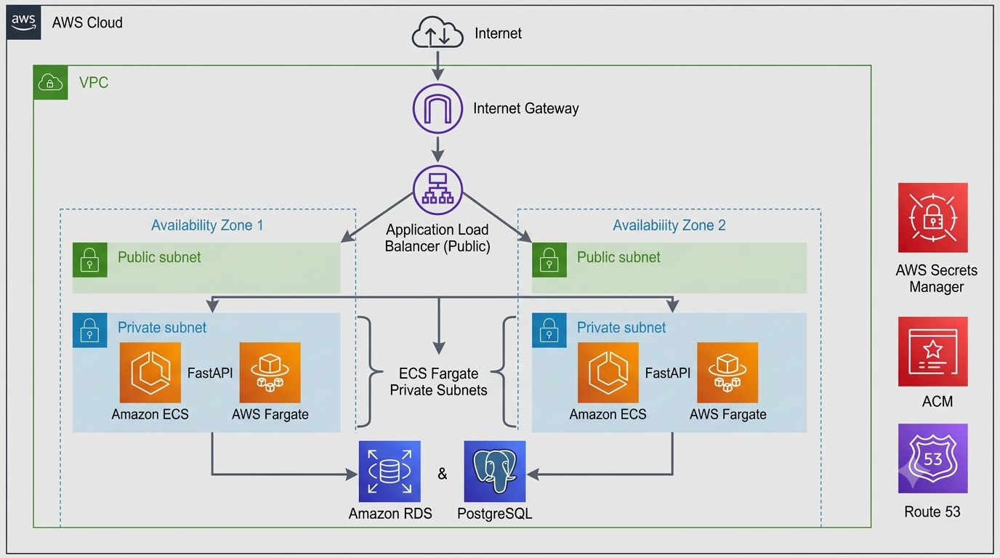

# FastAPI and PostgreSQL on LocalStack

This guide runs the project locally on Windows with PowerShell. LocalStack
simulates AWS services; it does **not** deploy anything to a real AWS account.

The workflow:

1. Start LocalStack.
2. Create an S3 bucket for Terraform state.
3. Use Terraform to create the network, RDS, ECR, ECS, ALB, secrets and logs.
4. Build and push the app image, then start the ECS task.
5. Access the app through the LocalStack ALB.

For the two-Availability-Zone infrastructure diagram, see the
[project architecture](./localstack-fastapi-deployment/README.md#architecture).

## Architecture



## Step 1: Check for an existing LocalStack

From any directory:

```powershell
docker ps -a
```

Ports `4566` and `4510-4559` must be available for this project's LocalStack.

## Step 2: Start LocalStack

From the repository root:

```powershell
cd D:\trustify\localstack-fastapi-deployment
```

Enter your LocalStack token when prompted:

```powershell
$secure = Read-Host "LocalStack token" -AsSecureString
$ptr = [Runtime.InteropServices.Marshal]::SecureStringToBSTR($secure)
try { $env:LOCALSTACK_AUTH_TOKEN = [Runtime.InteropServices.Marshal]::PtrToStringBSTR($ptr) }
finally { [Runtime.InteropServices.Marshal]::ZeroFreeBSTR($ptr) }
```

Build and start LocalStack:

```powershell
docker compose -f localstack\compose.yml up -d --build
docker compose -f localstack\compose.yml ps
curl.exe http://localhost:4566/_localstack/health
```

The [LocalStack Dockerfile](./localstack-fastapi-deployment/localstack/Dockerfile) adds a library needed by PostgreSQL.

The [Compose file](./localstack-fastapi-deployment/localstack/compose.yml) enables persistence in a Docker volume.

PostgreSQL runs inside LocalStack; the FastAPI app runs in a separate ECS-managed container.

## Step 3: Set LocalStack credentials and database password

Change to the Terraform directory:

```powershell
cd D:\trustify\localstack-fastapi-deployment\terraform

$env:AWS_ACCESS_KEY_ID = "$value"
$env:AWS_SECRET_ACCESS_KEY = "$value"
$env:AWS_DEFAULT_REGION = "$value"
```

These are dummy credentials for LocalStack, not real AWS credentials.

Choose a database password containing **at least eight letters and digits only**.
Enter it when prompted:

```powershell
$secure = Read-Host "Database password" -AsSecureString
$ptr = [Runtime.InteropServices.Marshal]::SecureStringToBSTR($secure)
try { $env:TF_VAR_db_password = [Runtime.InteropServices.Marshal]::PtrToStringBSTR($ptr) }
finally { [Runtime.InteropServices.Marshal]::ZeroFreeBSTR($ptr) }
```

Remember the password and use the same one for future applies and database queries.

Do not put it in a committed file.

Terraform state and its backups contain the password, even though Terraform hides it in normal output.

## Step 4: Create the Terraform state bucket

In the Terraform directory, list existing LocalStack buckets:

```powershell
aws --endpoint-url http://localhost:4566 s3api list-buckets --query "Buckets[].Name"
```

**Only for a fresh installation**, if `fastapi-local-terraform-state` is not
listed, create it and enable versioning:

```powershell
aws --endpoint-url http://localhost:4566 s3api create-bucket `
  --bucket fastapi-local-terraform-state

aws --endpoint-url http://localhost:4566 s3api put-bucket-versioning `
  --bucket fastapi-local-terraform-state --versioning-configuration Status=Enabled
```

Verify that the bucket exists and versioning is enabled:

```powershell
aws --endpoint-url http://localhost:4566 s3api head-bucket `
  --bucket fastapi-local-terraform-state

aws --endpoint-url http://localhost:4566 s3api get-bucket-versioning `
  --bucket fastapi-local-terraform-state
```

`head-bucket` returns no output on success. The second command should show
`"Status": "Enabled"`. If either command fails, check the error before
continuing.

If the bucket exists, do not recreate or overwrite it blindly. Check who owns
it and whether it already contains state. Terraform needs this bucket before
it can store its state there.

## Step 5: Initialize and create the infrastructure

Still in the Terraform directory:

```powershell
terraform init -backend-config="environments\dev\backend.hcl"
terraform validate
terraform apply -var-file="environments\dev\terraform.tfvars" -var="desired_count=0"
```

Review the plan and type `yes` to apply it. The first RDS creation can take
several minutes.

Terraform creates two public and two private subnets across two simulated
Availability Zones. The ALB uses the public subnets; ECS and RDS use the
private subnets. It also creates Secrets Manager, ECR and CloudWatch resources.
The ECS services initially have **zero tasks**, so they do not try to start
before the image is available.

The state is stored in LocalStack S3 at:

```text
s3://fastapi-local-terraform-state/dev/terraform.tfstate
```

Verify the state object:

```powershell
aws --endpoint-url http://localhost:4566 s3api head-object `
  --bucket fastapi-local-terraform-state --key dev/terraform.tfstate
```

## Step 6: Build and push the app image

Still in the Terraform directory:

```powershell
$repo = terraform output -raw ecr_repository_url
docker build -t "${repo}:latest" ..\compose
docker push "${repo}:latest"
```

This builds the FastAPI app from its  [Dockerfile](./localstack-fastapi-deployment/compose/Dockerfile) and pushes it to the LocalStack ECR repository.

## Step 7: Start the app

Still in the Terraform directory:

```powershell
terraform apply -var-file="environments\dev\terraform.tfvars"
```

Review the plan and type `yes`. Check both ECS services:

```powershell
$services = terraform output -json ecs_service_names | ConvertFrom-Json
aws --endpoint-url http://localhost:4566 ecs describe-services `
  --cluster (terraform output -raw ecs_cluster_name) `
  --services $services `
  --query "services[].{Name:serviceName,Desired:desiredCount,Running:runningCount,Subnets:networkConfiguration.awsvpcConfiguration.subnets}" --output json
```

Each service should have `Desired` and `Running` equal to `1`, and a different
private subnet. The dev configuration requests two tasks total, one per
subnet. LocalStack may report an incorrect task AZ even when the subnet is in
another AZ; check the subnet's AZ separately.

List tasks for each service:

```powershell
foreach ($service in $services) {
  aws --endpoint-url http://localhost:4566 ecs list-tasks `
    --cluster (terraform output -raw ecs_cluster_name) --service-name $service
}
```

Check the ALB's registered targets:

```powershell
$targetGroup = aws --endpoint-url http://localhost:4566 elbv2 describe-target-groups `
  --names fastapi-local --query "TargetGroups[0].TargetGroupArn" --output text
aws --endpoint-url http://localhost:4566 elbv2 describe-target-health `
  --target-group-arn $targetGroup --output json
```

For the current LocalStack version, two services can run but only one target
may be registered when both tasks share a host IP. Check for **two healthy
targets** before claiming that the ALB routes to both tasks.

## Step 8: Access and test the app

Still in the Terraform directory:

```powershell
$url = terraform output -raw https_api_url
Write-Output $url
curl.exe "$url/health"
curl.exe "$url/db-check"
```

Expected results:

```json
{"status":"ok"}
{"db_status":"ok","result":1}
```

Open the API documentation:

```powershell
Start-Process "$url/docs"
```

Use the HTTPS ALB URL shown by Terraform, normally
`https://fastapi-local.elb.localhost.localstack.cloud:4566`. Do not use
`https://localhost:<container-port>`: that direct container port uses HTTP
and may change. LocalStack's HTTPS certificate is for local testing; client
trust depends on your LocalStack and browser setup.

## Step 9: Query the database

Still in the Terraform directory, find the current RDS port:

```powershell
$dbPort = aws --endpoint-url http://localhost:4566 rds describe-db-instances `
  --db-instance-identifier fastapi-local `
  --query "DBInstances[0].Endpoint.Port" --output text
Write-Output $dbPort
```

The port can change when RDS is recreated. Connect from the LocalStack
container:

```powershell
cd D:\trustify\localstack-fastapi-deployment
docker compose -f localstack\compose.yml exec localstack `
  psql -h 127.0.0.1 -p $dbPort -U appuser -d demo_db
```

Enter the database password you chose in step 3. Then try:

```sql
SELECT 1;
\dt
```

`SELECT 1` checks the connection; `\dt` lists tables. The demo does not create
application tables. Type `\q` to exit.

## Step 10: Stop or clean up

To keep the lab for later, from the project directory:

```powershell
docker compose -f localstack\compose.yml stop
```

To start it again, set `LOCALSTACK_AUTH_TOKEN` as in step 2, then run:

```powershell
docker compose -f localstack\compose.yml start
```

The Compose setup enables persistence, but LocalStack S3 is not an independent
backup. Keep a protected backup if the state is important.

To **destroy this lab's Terraform resources**, start LocalStack first. From the
Terraform directory, set the same password as in step 3, then run:

```powershell
terraform destroy -var-file="environments\dev\terraform.tfvars"
```

Review the plan and type `yes`. Then stop and remove only this project's
Compose container:

```powershell
cd D:\trustify\localstack-fastapi-deployment
docker compose -f localstack\compose.yml down
```

The state bucket and Docker volume are intentionally retained. They and any
local state backups can contain the password. Remove them only when you are
sure they are no longer needed.

## Troubleshooting

- **Invalid password:** Use at least eight letters and digits, with no spaces or
  symbols. Use the same password on later applies.
- **RDS creation fails with a missing `libpython3.14` library:** Check that you
  started the project's LocalStack image from step 2, not a different container.
- **`/db-check` fails:** Check that RDS is available and ECS is running. The
  task must resolve `localhost.localstack.cloud` to LocalStack on its Docker
  network. The database port is supplied by Terraform.
- **HTTPS protocol error:** Use the ALB URL from `terraform output -raw https_api_url`, not the direct container port.
- **Inspect application logs:** From the Terraform directory:

  ```powershell
  aws --endpoint-url http://localhost:4566 logs filter-log-events `
    --log-group-name (terraform output -raw log_group_name)
  ```

## Lab limitations

This lab is not a real AWS deployment. LocalStack does not prove real network
isolation, IAM enforcement or database failover. Although RDS requests Multi-AZ,
there is no readable replica, and failover is not verified.
ECS task AZ reporting and ALB target registration can also differ from AWS;
running two services does not by itself prove routing to both tasks.
